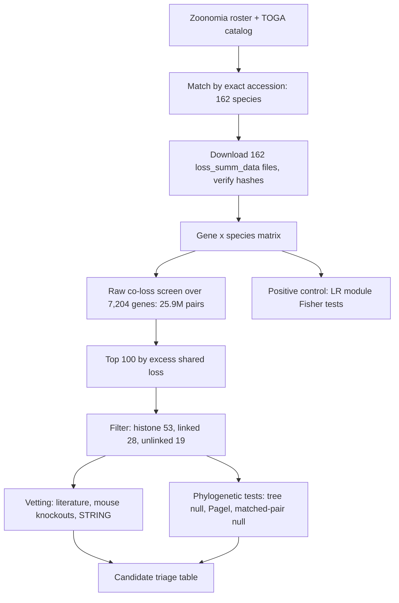

# Study guide: the co-elimination project

A self-contained explanation of what this project is, the vocabulary, the workflow, the statistics, what has been
found, what is wrong or unfinished, and how to talk about it. Numbers quoted here were checked against the files in this
repository on 2026-10-21 unless marked "unverified". Companion files: `notes/session_2026-10-21.md` (changes and open items),
`results/triage/candidate_triage.tsv` (current candidate ranking), `ENVIRONMENT.txt` (versions, hashes, seeds).

Contents
1. The question in plain language
2. Background you need
3. The data
4. The workflow, step by step
5. The statistics, explained from scratch
6. What has been found
7. Audit: what is wrong or fragile
8. How to describe this to the lab
9. Likely questions and answers
10. Reproducibility and file map
11. Open items
12. Glossary
13. Self-test

---

## 1. The question in plain language

Genes can be lost during evolution: mutations accumulate in a gene that is no longer needed until it can no longer make a
working protein. If a whole biological function becomes unnecessary in a lineage (for example because a trait is lost),
every gene that served only that function can decay. So **genes that are lost in the same species, repeatedly and
independently across the mammal tree, are candidates for working in the same pathway.**

The project asks: across 162 mammals, which pairs of genes are lost together more often than chance, in a way that is not just
explained by shared ancestry? The search is **phenotype-blind**: it does not start from a trait or disease; it scans all gene
pairs and looks at what the winners have in common afterwards.

A **positive control** checks that the method can see a known signal. Here it is the left-right (LR) asymmetry module
(DAND5, CIROP, CIROZ, PKD1L1, MMP21), a set of genes reported in the literature to act together in establishing left-right
body asymmetry (the project notes cite Szenker-Ravi et al. 2022 and 2025; the citations were not verified in this review).

## 2. Background you need

**Gene loss / pseudogenization.** A gene is "lost" when its coding sequence is disrupted by inactivating mutations:
frameshifts, premature stop codons, splice-site mutations, or deleted exons.

**Why co-loss suggests shared function.** If two genes only matter for the same function, relaxing selection on that function
relaxes it on both, and both can decay. Independent repeats strengthen the inference; a single ancestral loss inherited by
many descendants counts as one event.

**Independence is the central statistical problem.** Species are related. 13 cetaceans that all lack a gene most likely
inherited one loss. Treating them as 13 data points overstates the evidence. Everything in section 5 is about handling this.

**Orthologs and paralogs.** Orthologs are the "same gene" in different species (they split at speciation). Paralogs are copies
within one genome (they split at duplication). Calling a gene "lost" requires deciding which gene in the other species is
the ortholog; with multi-copy families (histones, KRAB zinc fingers) this is error-prone.

**Reference-based calling.** TOGA calls each gene relative to a reference species (human, assembly hg38). The question for
every species is "is the human gene's counterpart intact here?" TOGA's own README warns that because this is pairwise it cannot
tell a gene truly lost in the query from a gene that arose in the reference lineage: reference-specific genes look lost or
missing in every species that split before the gene appeared.

**Convergent loss.** The same gene lost independently in separate lineages (bats, cetaceans, carnivores). This is the evidence
a co-loss screen looks for.

## 3. The data

### 3.1 Sources
- **Zoonomia**: a consortium resource of 240+ mammal genomes aligned together. This project uses its species roster
  (`raw_data/zoonomia/zoonomia_mammal_assemblies.tsv`, 249 entries) and its species tree
  (`241-mammalian-2020v2.phast-242.nh`, 241 tips). Tree **branch lengths are substitutions per neutral site** (divergence),
  not years.
- **TOGA** (Tool to infer Orthologs from Genome Alignments): produces, for each query genome, a classification of each human
  gene. This project downloaded TOGA's precomputed `loss_summ_data.tsv.gz` for each selected species (about 273 MB total).
  Genomes, alignments and ortholog files were never downloaded and are not needed.
- **Ensembl map** (`raw_data/ensembl/ensembl_id_symbol_map.tsv`): translates `ENSG...` IDs to gene symbols and biotypes.

### 3.2 Choosing species
Rule: take a TOGA assembly only if its NCBI accession **exactly matches** the Zoonomia roster accession, so incompatible assembly
versions are never mixed.

| Outcome | Count |
|---|---|
| Eligible, exact accession | 157 |
| Eligible, exact accession, tip mapped by binomial name | 5 |
| **Total used** | **162** |
| Excluded: only an alternative assembly exists in TOGA | 62 |
| Excluded: exact assembly not in TOGA | 7 |
| Excluded: assembly source unverifiable | 9 |
| Reference species (human), not a query | 1 |

Files: `orthologs/zoonomia_toga_assembly_manifest.tsv` (all 241), `zoonomia_toga_eligible_assemblies.tsv` (the 162).

### 3.3 TOGA status codes
Every file has three kinds of row: `GENE`, `TRANSCRIPT`, `PROJECTION`. The project uses only `GENE` rows (19,464 per species).

| Code | Meaning | Share of all 3,153,168 calls |
|---|---|---|
| I | Intact | 74.7% |
| PI | Partially intact | 11.1% |
| UL | Uncertain loss | 4.5% |
| L | Lost | 4.5% |
| M | Missing (no usable alignment chain) | 2.9% |
| PG | Paralogous projection (best hit is a paralog) | 1.1% |
| PM | Partially missing (chain covers <50% of the coding sequence; a subclass of missing) | 1.1% |

Missing and partially missing are **data gaps**, not biology. Uncertain loss is evidence too weak to call.

### 3.4 The matrix
`analysis/gene_status_matrix.tsv`: 19,464 gene rows x 162 species columns, each cell one status code, no empty cells.
Rows are Ensembl gene IDs. Built by `src/build_gene_status_matrix.py`, which refuses to run if any file's size or SHA-256 differs from the manifest.

## 4. The workflow, step by step

### 4.1 Inventory and species matching
`src/inventory_sources.py`, `inventory_zoonomia_roster.py`, `inventory_toga_files.py`, `match_zoonomia_toga.py`,
`qc_toga_availability.py`, `export_assembly_review.py`. Outputs go to `raw_data/` and `orthologs/`.

### 4.2 Download and verification
`src/download_toga_status.py` fetches the 162 files, records size, SHA-256 and row counts per file in `download_manifest.tsv`
(160 downloaded, 2 already valid, 0 failures).

### 4.3 Build the matrix
`src/build_gene_status_matrix.py` checks sizes and hashes, requires the same gene set in every species, rejects unknown codes or
duplicates, writes the matrix and `gene_status_matrix.qc.json`.

### 4.4 Raw co-loss screen
`src/agentic_candidate_triage.py` (the name is historical: it is deterministic ranking plus text prompts for later human or
model review; no AI judges anything). Settings used: only **L** counts as loss, only **I** as retained; PI, UL, M, PM, PG are
**ignored cell by cell** (excluded from that pair's denominator, not treated as intact).
Thresholds: gene lost in at least 2 species, pair shares at least 2 losses, at least 20 comparable species.

For a pair of genes A and B:
- comparable species N = species where both genes are I or L
- n_A, n_B = losses of each among comparable species; shared = species where both are L
- **naive expected** = n_A x n_B / N (shared losses if the two were independent)
- **excess** = shared - naive expected (the ranking key)
- **Jaccard** = shared / (species with either lost)
- **enrichment** = shared / naive expected

Worked example (MCTS2 and CIROZ, from `ranked_co_loss_candidates.tsv`): N = 131, n_A = 83, n_B = 88, shared = 82.
Expected = 83 x 88 / 131 = 55.8; excess = 26.2; Jaccard = 82 / 89 = 0.92; enrichment = 1.47.

Counts: 7,204 genes eligible (>= 2 losses), 25,945,206 pairs scored, 7,389,576 pairs met the thresholds, top 100 kept.

Why this ranking is biased: excess grows with how often each gene is lost, so frequently lost genes dominate regardless of any real
relationship.

### 4.5 Cleaning the top 100
Done in `notebooks/Project1.ipynb` (not yet in a script):
- **Histone-histone: 53 pairs.** Multi-copy clustered families; paralog confusion.
- **Physically linked (<1 Mb): 28 pairs.** Nearby genes can be removed by a single deletion, so not independent events.
- **Unlinked: 19 pairs.** The interesting set. Two of the genes have no gene symbol.

### 4.6 Vetting
`src/vet_unlinked_pairs.py`, `lookup_mouse_phenotypes.py`: literature counts (Europe PMC), mouse knockout phenotypes, STRING
interaction scores, plus clade breadth (in how many clades both genes are lost). STRING score 0 is ambiguous: it can mean no
known link or no data. Output: `results/vetting/`.

### 4.7 Positive control: LR module
Notebook last cell and `src/plot_lr_module.py`: one-sided Fisher tests on all 10 pairs of the 5 genes, CIROZ loss by clade,
heatmaps and tree figures in `results/lr_module/`. Clade labels were assigned **by hand by genus**.

### 4.8 Phylogenetic correction
- `src/phylo_null_coloss.py`: tree-simulation null (section 5.5).
- `src/phylogenetic_candidate_test.py`: Pagel test (section 5.6); parallel runner `src/run_pagel_unlinked_parallel.sh`, merged by `src/merge_pagel_chunks.py`.
- `src/matched_pair_null.py`: empirical null from matched gene pairs (section 5.7).
- `src/make_candidate_triage.py`: combines everything into `results/triage/candidate_triage.tsv`.

### 4.9 Audit and environment
`src/audit_checks.py` (integrity and bias checks, `results/audit/`), `src/record_environment.py` (`ENVIRONMENT.txt`,
`requirements.lock.txt`). Whole pipeline order: `run_all_analysis.sh`.

## 5. The statistics, explained from scratch

### 5.1 Fisher's exact test (2x2 table)
Question: are two genes' loss patterns associated? Build a table across species:

| | B lost | B not lost |
|---|---|---|
| A lost | both | only A |
| A not lost | only B | neither |

Real example (CIROP and MMP21, 162 species): both = 20, only CIROP = 8, only MMP21 = 1, neither = 133.
**Odds ratio** = (20 x 133) / (8 x 1) = 332.5: the odds that MMP21 is lost are 332x higher when CIROP is lost.
**One-sided** ("greater") tests only for more overlap than chance. p = 3.3e-18. OR = infinity when a cell is zero (CIROP-CIROZ,
CIROZ-MMP21, because CIROZ is lost whenever the other gene is).
Weakness: it treats species as independent, so p-values are too small when losses are clade-clustered.

### 5.2 p-values, multiple testing, BH
A **p-value** is the probability of a result at least this extreme if there were no association. With many tests, some small
p-values appear by chance. **Benjamini-Hochberg (BH)** converts p-values to **q-values**, the expected false-discovery rate when
you call everything below that q significant. All 10 LR pairs have q < 0.001 by BH.

### 5.3 Post-selection inference
The 19 pairs were chosen because they scored highest among 7.4M. P-values computed on them afterwards look better than they should.
Correcting only across 19 (or 29) tests does not undo selecting from millions. Every p-value on the candidates is exploratory.
Genome-wide significance for such pairs would need p near 1e-8 or smaller, which none of the empirical tests can reach.

### 5.4 Why phylogeny matters
Related species share states. A model of evolution on the tree asks how many independent changes are needed to explain the data.
CIROZ is lost in nearly all bats, carnivores, cetaceans, ruminants but few primates: a handful of events, not 91.

### 5.5 Tree-simulation null (`phylo_null_coloss.py`)
Model for one gene on the tree: a two-state continuous-time Markov chain (intact <-> lost) with rate **a** (intact to lost) and
**b** (lost to intact). The root is fixed intact. Rates are fitted by maximum likelihood using Felsenstein's pruning algorithm
(compute likelihood from the tips up). Maximum likelihood typically finds b near 0 (loss is effectively irreversible).
Then simulate many independent histories for each gene on the real tree and ask how often two independent genes share at least
as many losses as observed.

Two lessons from this project:
1. **Calibration.** The fitted rate alone did not reproduce each gene's observed loss frequency (MCTS2: 19% simulated vs 59% observed), which made
   the null too low for some pairs and too high for others. Fix: keep only simulations whose loss count is within 10% (min 2) of observed.
2. **Lineage-wide effects.** Independent genes cannot create the observation that some clades lose many genes at once. Scaling branches by
   lineage loss burden (`BURDEN_AWARE`) barely changed results. After both fixes the null still passes gene-family blocks and only 4 of 10
   LR control pairs, so it cannot discriminate on its own.

### 5.6 Pagel's test of correlated evolution
Pagel (1994) models two binary traits on a tree with a 4-state chain (A,B) in {00, 01, 10, 11}.
- **Independent model**: 4 rate parameters (each gene changes on its own).
- **Dependent model**: 8 rate parameters (each gene's rates depend on the other's state).
The **likelihood ratio test (LRT)** = 2 x (log-likelihood dependent - log-likelihood independent), compared with chi-squared with 4 df
(nominal). A large LRT means knowing one gene's state helps predict the other's changes.
Fitting issues found: the optimizer can stop at a local maximum; the models are nested so the dependent fit can never truly be worse.
Fix: several random starts plus a warm start of the dependent model from the independent fit. For the 19 pairs 15 LRTs were unchanged and 4 moved by 0.4 to 2.3 units.
The p-values still assume the chi-squared reference distribution holds, which is approximate here.

### 5.7 Matched-pair empirical null (`matched_pair_null.py`)
No model. For pair (A, B), take every gene with a similar total loss count to A (within 10%, min 2) and every gene similar to B, and count
how many such pairs share at least as many losses within the pair's comparable species. This inherits the real clade structure, species burden and
assembly effects of the data. Result column `other_matched_pairs_as_extreme`:
- 0 or 1: the pair stands alone among its peers.
- 10 or more (here up to 273): a **block**, many genes lost in the same species set, likely a family or lineage effect.
Limit: the top-ranked pairs sit at the top of their own groups by construction, so this removes blocks but does not prove the rest.

### 5.8 Species loss burden and assembly quality
**Burden** = number of L calls per species (mean 881, range 290 to 1,712). **Contig N50 / scaffold N50** measure assembly contiguity.
Poor assemblies produce more M, PM and UL calls, and loss calls correlate weakly with N50 (below).

## 6. What has been found

### 6.1 Data layer (verified)
- 162/162 raw files match recorded hashes; rebuilding the matrix from them reproduces `gene_status_matrix.tsv` exactly.
- Tree, roster and TOGA catalog hashes match the manifest.

### 6.2 LR module positive control
- All 10 pairwise Fisher tests are significant (p from 4.5e-22 to 3.6e-5). Strongest: CIROP-PKD1L1 (25 species lose both, OR about 271), CIROP-MMP21 (OR about 333), DAND5-CIROP.
- Intact status: DAND5 123/162, CIROP 121/162, MMP21 110/162; PKD1L1 has 71 UL, so those four were never going to stand out in a loss screen.
- In the matched-pair null all 10 LR pairs are extreme (1 to 59 matched pairs as extreme, counting the pair itself, out of 29k to 107k). That supports the positive control independently of Fisher.
- **The raw screen did not recover the module**: the 10 pairs rank 1,241 to 162,185 of 7,389,576 (`results/audit/lr_module_rank_in_screen.tsv`). CIROZ reaches the top 100 only through MCTS2.

### 6.3 CIROZ losses by clade (hand-assigned clades)
Lost in 91 of 162 species: Cetacea 13/13, ruminants and other artiodactyls 12/12, Chiroptera 23/24, Carnivora 17/18, Afrotheria 4/4,
Perissodactyla 5/6, Eulipotyphla 5/6, Rodentia 8/43, Xenarthra 1/5, Primates 1/27, Lagomorpha 0/2. Strongly clade-clustered.

### 6.4 Candidates (current triage)
| Tier | Pairs | Notes |
|---|---|---|
| lead | TYMP-ACY3, MCTS2-CIROZ, IGSF22-SPEGNB, CALML6-IGSF22, FAM200A-FAM200B | passes tree null and Pagel, not a block. MCTS2-CIROZ tree-null q = 0.0495 (borderline). FAM200A/B is a paralog pair, so artifact is not excluded |
| weak | CETP-MCTS2, MCTS2-FPR1 | fail at least one test |
| block | TIGD7, ZNF404, ZNF514, ZNF677, KRABD2, LRRC70, MAGEF1 pairs; ENSG00000203812-ENSG00000272196 | 12 to 273 equally overlapping matched pairs |

MCTS2 appears in three of the five original survivors; whether its loss calls reflect biology or a retrocopy/paralog artifact is unchecked.
Gene functions for TYMP and ACY3 (metabolic enzymes) are from memory and unverified.
Treat "lead" as "worth examining", not as a finding: all were selected from millions of pairs and none has been validated biologically.

## 7. Audit: what is wrong or fragile

1. **Overstated claim.** "The blind screen recovered CIROZ" is not supported (section 6.2). A correction is appended to the status report.
2. **Ranking bias.** Excess favors high-frequency genes; 81 of the top 100 were histone or linked pairs.
3. **Assembly quality leaks into calls.** Spearman correlations of per-species status counts with assembly metrics:

   | Status | vs contig N50 | vs scaffold N50 |
   |---|---|---|
   | PM | -0.35 | -0.92 |
   | M | -0.61 | 0.09 |
   | UL | -0.29 | 0.00 |
   | L | -0.21 (p = 0.008) | -0.07 |
   | I | +0.73 | +0.41 |

   `Tupaia_chinensis` has a contig N50 near 3 kb, only 2,452 intact genes, 1,412 L and 5,036 UL calls. Not yet excluded.
4. **Reference bias.** Primates, closest to human, have the fewest L calls (about 290 to 400); distant lineages accumulate more. Also, per TOGA's README,
   genes that arose in the human lineage look lost in older lineages. This has not been tested for the candidates.
5. **Non-independent tips.** `Canis_lupus` and `Canis_lupus_familiaris`; two `Ceratotherium_simum` tips.
6. **Hand-assigned clades**, and the filter steps (histone, linkage) live only in the notebook.
7. **Selection effects** (section 5.3).
8. **Nulls disagree.** The independent-gene tree null passes junk blocks and only 4/10 LR controls; matched-pair null separates them. No single test is
   trustworthy alone, so the triage requires agreement.

## 8. How to describe this to the lab

Safe statements:
- "I built a gene-by-species matrix of TOGA loss calls for 162 Zoonomia mammals and verified it end to end."
- "A known left-right asymmetry module shows strong co-loss in these data."
- "I screened 25.9M gene pairs; most top hits were histone or linked pairs, so I filtered them."
- "After phylogenetic correction a few pairs remain as hypotheses (TYMP-ACY3, MCTS2-CIROZ and others); they are unvalidated."
- "I audited the pipeline and found assembly-quality and reference biases, which I am addressing."

Avoid:
- "The screen recovered the LR module."
- Presenting any candidate as a discovery or quoting Pagel or tree-null p-values as proof.
- Saying the 19 pairs are functionally related.

## 9. Likely questions and answers

- **Why human as reference?** TOGA's precomputed Zoonomia-scale calls use human (hg38) as reference; it has the best annotation.
  Cost: reference-lineage bias (section 7).
- **Why only L and I?** Mixing in UL, M, PM or PG would treat uncertainty as intact or lost. They are dropped per pair instead.
- **Why not use UL as lost?** It is by definition uncertain; including it raises false losses. A sensitivity analysis is a sensible next step.
- **How many independent losses are there?** Unknown yet. Estimating the number of independent transitions per gene on the tree is a good addition.
- **Could assembly errors explain it?** Partly, yes: see the N50 correlations. Excluding poor assemblies and re-running is planned.
- **Is it significant?** The candidates are exploratory. Honest answer: the LR control is strong, the candidate list is hypothesis-generating.
- **Why trust the matrix?** Hash-verified and independently rebuilt.
- **What would validate a candidate?** Independent evidence for shared function: pathway or expression data, human or mouse phenotypes, convergent loss in
  species with a shared trait, or experiments.
- **Why do you need a null model at all?** Because related species share losses; without it nearly any pair of frequently lost genes looks associated.

## 10. Reproducibility and file map

| Path | Content |
|---|---|
| `raw_data/` | Zoonomia roster and tree, TOGA catalog, 162 status files, Ensembl map (not tracked except inventories) |
| `orthologs/` | Assembly manifests and eligibility tables |
| `analysis/` | `gene_status_matrix.tsv` (+ QC json); the TSV is git-ignored |
| `results/agentic_triage/` | Screen output (top 100, subsets, manifest) |
| `results/figures/`, `results/lr_module/` | Slide and LR figures and tables |
| `results/vetting/` | Literature, knockout phenotype, STRING tables |
| `results/phylo_null/`, `phylogenetic_validation*/`, `matched_pair_null/`, `triage/`, `audit/` | Phylogenetic correction and audit outputs |
| `src/` | All scripts; `run_all_analysis.sh` gives run order |
| `notes/`, `writeups/` | Session notes, status report |
| `ENVIRONMENT.txt`, `requirements.lock.txt` | Versions, hashes, seeds |

Seeds: tree null `default_rng(20261014)`; Pagel random starts `default_rng(20261021 + parameter_count)`.
Not yet verified: a full end-to-end rerun of `run_all_analysis.sh` and exact reproduction of the slow tree-null run.
`logs/` is git-ignored; run logs live there.

## 11. Open items
1. Move the notebook-only candidate subsetting (symbolic, no-histone, unlinked) into a script.
2. Exclude or flag `Tupaia_chinensis`; collapse near-duplicate tips; rerun.
3. Replace hand-assigned clades with a sourced taxonomy.
4. Test whether candidate losses are reference-lineage-specific genes.
5. Count independent loss events per gene on the tree; run a sensitivity analysis with UL as lost.
6. Pathway/GO analysis and biological check of the lead pairs (including MCTS2).
7. Verify the literature citations.
8. Final short list and a validation plan.

## 12. Glossary

- **Assembly**: an assembled genome sequence for one individual/species, identified by an accession.
- **Benjamini-Hochberg (BH)**: multiple-testing correction controlling the false-discovery rate.
- **Branch length**: amount of divergence along a tree branch (here substitutions per neutral site).
- **Burden (loss burden)**: number of lost genes in a species or lineage.
- **Chain / alignment chain**: a block of aligned sequence between two genomes used by TOGA to find a gene's counterpart.
- **Clade**: a group containing an ancestor and all its descendants (e.g. bats).
- **Co-elimination / co-loss**: genes lost in the same species.
- **Comparable species**: for a pair, species where both genes have I or L calls.
- **Contig N50 / scaffold N50**: assembly contiguity; higher is better.
- **CTMC**: continuous-time Markov chain, a model of state changes over time on branches.
- **Dependent / independent model**: Pagel's models where two traits do or do not influence each other's rates.
- **Ensembl ID (ENSG)**: stable gene identifier.
- **Excess**: observed shared losses minus those expected if the genes were independent.
- **FDR**: false-discovery rate, expected share of false positives among calls.
- **Fisher's exact test**: exact test of association in a 2x2 table.
- **Forward genomics**: starting from genomes and gene loss patterns to find genes linked to a trait (the idea behind phenotype-blind screens).
- **Hash (SHA-256)**: a fingerprint of a file; any change alters it.
- **Intact / lost / uncertain loss / partially intact / missing / partially missing / paralogous projection**: TOGA status codes (section 3.3).
- **Jaccard index**: overlap divided by union.
- **Likelihood / maximum likelihood**: how probable the data are under a model; ML picks parameters maximizing it.
- **LRT**: likelihood ratio test comparing nested models.
- **Linked genes**: genes physically close on a chromosome.
- **Matched-pair null**: empirical null from gene pairs with similar loss counts (section 5.7).
- **Naive expected**: n_A x n_B / N, ignoring ancestry.
- **Nested models**: one model is a special case of the other.
- **Odds ratio**: ratio of odds from a 2x2 table; infinity if a cell is zero.
- **Ortholog / paralog**: same gene across species / duplicate within a species.
- **Pagel test**: test of correlated evolution of two binary traits on a tree.
- **Paralogous projection (PG)**: TOGA's best match is a paralog.
- **Phenotype-agnostic / blind**: not guided by a trait chosen in advance.
- **phyloP**: a conservation score (planned supporting evidence; not used yet).
- **Phylogenetic non-independence**: shared ancestry makes species not independent samples.
- **Positive control**: a known case used to confirm the method works.
- **Post-selection inference**: p-values computed after choosing the best results are optimistic.
- **Pruning algorithm (Felsenstein)**: efficient likelihood computation on a tree from tips to root.
- **q-value**: BH-adjusted p-value.
- **Reference species**: the genome (human) all calls are made against.
- **Root prior**: assumed state at the tree's root (here: intact for the tree null).
- **STRING**: database of protein-protein interactions.
- **TOGA**: Tool to infer Orthologs from Genome Alignments.
- **Tree null**: null built by simulating genes independently on the tree.
- **Zoonomia**: consortium of 240+ aligned mammal genomes.

## 13. Self-test

1. Why can't you treat 13 cetaceans losing a gene as 13 independent observations?
2. Compute naive expected shared losses for two genes lost in 40 and 50 of 120 comparable species.
3. Why are M and PM excluded from the screen instead of being counted as intact?
4. What does an odds ratio of infinity mean, and why does CIROZ produce it?
5. Why does ranking by excess favor frequently lost genes?
6. What is the difference between the screen's ranking and a significance test?
7. Why were histone pairs and physically linked pairs removed?
8. What went wrong with the first tree null, and how was it detected?
9. What does it mean that the independent and dependent Pagel models are nested?
10. What does "other matched pairs as extreme = 200" tell you about a candidate?
11. Why does the LR module Fisher result not show the screen works?
12. Name three confounds that make a lost call not equal to true biological loss.
13. Which statements are safe to make on Nov 8 and which are not?

Answers to 2: 40 x 50 / 120 = 16.7.
